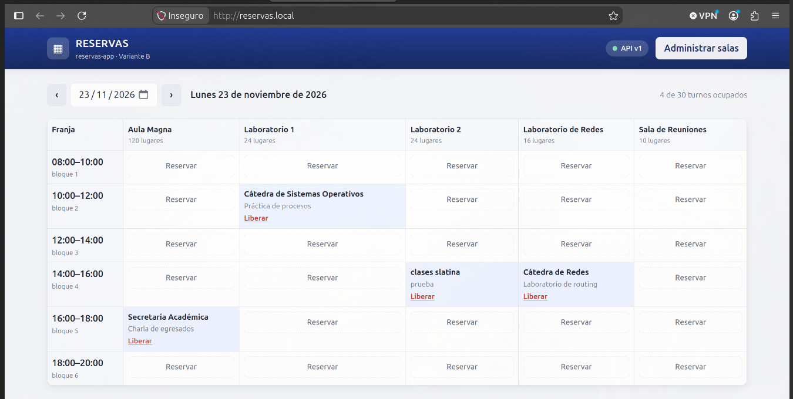
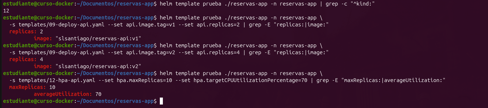

# Informe de Funcionamiento — reservas-app (Variante B)

Este documento reúne las evidencias empíricas del despliegue y funcionamiento de **reservas-app** en Kubernetes y Helm, organizadas según los cinco puntos obligatorios de la entrega final más una verificación adicional de persistencia en base de datos.

> Cada evidencia incluye el comando exacto que la produjo, su salida y/o captura almacenada en [`informe/`](./informe) junto con una breve explicación técnica de lo observado.

---

## 1. Aplicación respondiendo a través del Ingress (con reserva creada desde el navegador)

### Comandos ejecutados

```bash
kubectl get ingress,svc,pods -n reservas-app
curl -s http://reservas.local/api/health
curl -s http://reservas.local/api/reservas
# Verificación del falso positivo SPA (devuelve HTML index.html, no JSON):
curl -s http://reservas.local/reservas | head -n 5
```

### Salida registrada

```text
# TODO: Pegar aquí la salida real de kubectl get ingress,svc,pods y los curl contra reservas.local
```

### Captura desde el navegador

<!-- Guardar la captura del navegador en informe/01-ingress-ui.png mostrando http://reservas.local con una reserva creada manualmente desde la interfaz -->


### Explicación técnica

- `reservas-app-ingress` expone el host `reservas.local` con una única regla `/` dirigida al servicio `reservas-frontend:8080`.
- Nginx dentro de `reservas-frontend` sirve la SPA y reenvía `/api/*` hacia `reservas-api:3000/*`. Por eso `GET /api/health` devuelve JSON (`{"status":"ok","db":"ok","version":"v1"}`) y `GET /api/reservas` devuelve el arreglo JSON de reservas, mientras que `GET /reservas` devuelve `index.html` por la directiva `try_files` de la SPA.
- En la captura del navegador se verifica la carga completa de la grilla en `http://reservas.local` con una reserva creada manualmente desde la interfaz.

---

## 2. Escalado automático bajo carga con HPA (`kubectl get hpa -w`)

El objeto `reservas-api-hpa` monitorea el uso de CPU de `reservas-api` contra `resources.requests.cpu: 100m` con un objetivo de utilización promedio del **50%** (`minReplicas: 2`, `maxReplicas: 6`).

### Comandos ejecutados

```bash
# Terminal 1 — Monitoreo continuo del HPA
kubectl get hpa -n reservas-app -w

# Terminal 2 — Generación de carga contra el Service interno de la API
kubectl run carga-1 --image=busybox:1.36 --restart=Never -n reservas-app -- \
  /bin/sh -c "while true; do wget -q -O- http://reservas-api:3000/reservas > /dev/null; done"
# (Si 1 Pod no supera el 50%, lanzar carga-2 y carga-3 en paralelo y eliminarlos al finalizar)
```

### Salida registrada (`kubectl get hpa -w`)

```text
# TODO: Pegar aquí la traza completa de kubectl get hpa -n reservas-app -w mostrando:
# 1) estado inicial (TARGETS con porcentaje real, REPLICAS=2)
# 2) subida de CPU >50% y escalado de REPLICAS hacia 6
# 3) al detener la carga, descenso progresivo de REPLICAS de vuelta a 2 tras la ventana de estabilización
```

### Captura de pantalla

<!-- Guardar la captura en informe/02-hpa-escalado.png -->


### Explicación técnica

- Gracias a `metrics-server` y a la declaración explícita de `resources.requests.cpu: 100m` en `09-deploy-api.yaml`, la columna `TARGETS` reporta porcentajes reales (y no `<unknown>`).
- Al inyectar peticiones reiteradas contra `GET /reservas` (consulta con `JOIN` entre `reservas` y `salas`), el consumo de CPU supera el umbral del `50%` y el HPA incrementa las réplicas desde `2` hacia `6`.
- Al eliminar los Pods generadores de carga, la utilización cae por debajo del umbral y, una vez transcurrida la ventana de estabilización de *scale-down* (~5 minutos), el HPA retorna las réplicas a su mínimo configurado (`2`).

---

## 3. Ciclo de vida con Helm (`install`, `upgrade`, `history` y `rollback`)

### Comandos ejecutados

```bash
# 1. Instalar la release inicial (revisión 1, API v1)
helm install reservas ./reservas-app -n reservas-app --create-namespace
curl -s http://reservas.local/api/health

# 2. Actualizar únicamente el tag de la API a v2 (revisión 2)
helm upgrade reservas ./reservas-app -n reservas-app --set api.image.tag=v2
kubectl rollout status deployment/reservas-api -n reservas-app
curl -s http://reservas.local/api/health

# 3. Consultar historial y revertir a la revisión 1 (revisión 3)
helm history reservas -n reservas-app
helm rollback reservas 1 -n reservas-app
kubectl rollout status deployment/reservas-api -n reservas-app
curl -s http://reservas.local/api/health
helm history reservas -n reservas-app
```

### Salida registrada

```text
# TODO: Pegar aquí la salida de helm history reservas -n reservas-app (con las 3 revisiones)
# y las respuestas de curl -s http://reservas.local/api/health mostrando v1 -> v2 -> v1
```

### Captura de pantalla

<!-- Guardar la captura de helm history (y opcionalmente el badge API v2 / API v1 en el navegador) en informe/03-helm-history.png -->


### Explicación técnica

- El historial de Helm registra las **3 revisiones** completas: revisión `1` (`Install complete`, API `v1`), revisión `2` (`Upgrade complete`, API `v2` con `APP_VERSION=v2` horneada en el build) y revisión `3` (`Rollback to 1`, retorno a `v1`).
- El indicador de versión del frontend (`/api/health`) refleja la transición `v1` → `v2` → `v1` sin interrupción del servicio.
- Modificar `api.image.tag` en el `helm upgrade` actualiza exclusivamente `reservas-api` y **no modifica la imagen del frontend** (`slsantiago/reservas-frontend:v1`), demostrando que ambas capas mantienen ciclos de vida independientes.

---

## 4. Prueba de parametrización real de `values.yaml` (`helm template`)

Esta verificación demuestra que el Chart renderiza exactamente los **12 objetos** y que los valores definidos en `reservas-app/values.yaml` modifican efectivamente los manifiestos generados (no son parámetros decorativos).

### Comandos ejecutados

```bash
# 1. Verificar que el chart genera exactamente 12 objetos Kubernetes
helm template prueba ./reservas-app -n reservas-app | grep -c "^kind:"

# 2. Renderizar la plantilla de la API con valores distintos (v1 vs v2 y 2 vs 4 réplicas)
helm template prueba ./reservas-app -n reservas-app \
  -s templates/09-deploy-api.yaml --set api.image.tag=v1 --set api.replicas=2 | grep -E "replicas:|image:"

helm template prueba ./reservas-app -n reservas-app \
  -s templates/09-deploy-api.yaml --set api.image.tag=v2 --set api.replicas=4 | grep -E "replicas:|image:"

# 3. Renderizar la plantilla del HPA cambiando umbrales
helm template prueba ./reservas-app -n reservas-app \
  -s templates/12-hpa-api.yaml --set hpa.maxReplicas=10 --set hpa.targetCPUUtilizationPercentage=70 | grep -E "maxReplicas:|averageUtilization:"
```

### Salida registrada

```text
# TODO: Pegar aquí la salida real de los comandos helm template anteriores (conteo = 12 y diferencia visible entre v1/2 y v2/4)
```

### Captura de pantalla

<!-- Guardar la captura en informe/04-helm-template.png -->


### Explicación técnica

- El recuento de `^kind:` confirma exactamente **12 objetos** renderizados por el chart.
- Al variar `api.image.tag`, `api.replicas` y los umbrales de `hpa` mediante `--set`, los manifiestos resultantes cambian de manera inmediata y verificable (`slsantiago/reservas-api:v1` → `v2`, `replicas: 2` → `4`, `maxReplicas: 6` → `10`), probando que la parametrización de `values.yaml` es funcional y no decorativa.

---

## 5. Prueba de concurrencia con 3 réplicas de la API (Sexta entrega — Variante B)

Esta prueba acompaña a la pregunta 2 de [`ARQUITECTURA.md`](./ARQUITECTURA.md) y demuestra que, con **3 réplicas** de `reservas-api` atendiendo en paralelo, la restricción `CONSTRAINT sin_solapamiento UNIQUE (sala_id, fecha, franja)` de MySQL impide dobles reservas.

### Comandos ejecutados

```bash
# 1. Escalar la API a 3 réplicas y esperar disponibilidad
kubectl scale deployment reservas-api --replicas=3 -n reservas-app
kubectl rollout status deployment/reservas-api -n reservas-app

# 2. Disparar 30 solicitudes POST simultáneas para la misma sala, fecha y franja
for i in $(seq 1 30); do
  curl -s -o /dev/null -w "%{http_code}\n" -X POST http://reservas.local/api/reservas \
    -H 'Content-Type: application/json' \
    -d '{"sala_id":1,"fecha":"2026-12-01","franja":5,"responsable":"R'$i'"}' &
done | sort | uniq -c

# 3. Confirmar directamente en MySQL que se persistió exactamente 1 fila
kubectl exec deploy/reservas-db -n reservas-app -- \
  mysql -ureservas_user -preservas_pass reservasdb -e \
  "SELECT COUNT(*) FROM reservas WHERE sala_id=1 AND fecha='2026-12-01' AND franja=5;"

# 4. Restablecer la API a 2 réplicas
kubectl scale deployment reservas-api --replicas=2 -n reservas-app
```

### Salida registrada

```text
# TODO: Pegar aquí la salida real mostrando:
#       1 201
#      29 409
# y el resultado COUNT(*) = 1 de la consulta SQL en MySQL
```

### Captura de pantalla

<!-- Guardar la captura en informe/05-concurrencia.png -->


### Explicación técnica

- Aunque varias de las 30 solicitudes concurrentes superan simultáneamente el `SELECT` previo en las 3 réplicas de Node.js, la restricción `UNIQUE (sala_id, fecha, franja)` en MySQL serializa la escritura: exactamente **1 petición** obtiene `201 Created` y las **29 restantes** reciben `409 Conflict` (`ER_DUP_ENTRY`).
- La consulta `SELECT COUNT(*)` sobre `reservas-db` devuelve exactamente **`1`**, confirmando la integridad del dato.

---

## 6. Anexo — Verificación de persistencia de datos en MySQL (`PersistentVolumeClaim`)

### Comandos ejecutados

```bash
# 1. Crear una reserva de prueba
curl -s -X POST http://reservas.local/api/reservas \
  -H "Content-Type: application/json" \
  -d '{"sala_id":1,"fecha":"2026-12-10","franja":1,"responsable":"Prueba Persistencia","motivo":"Test PVC"}'

# 2. Eliminar el Pod de MySQL y verificar su recreación
kubectl delete pod -l app=reservas-db -n reservas-app
kubectl rollout status deployment/reservas-db -n reservas-app
kubectl get pods,pvc -n reservas-app

# 3. Verificar que la reserva creada sigue existiendo
curl -s "http://reservas.local/api/reservas?fecha=2026-12-10"
```

### Salida registrada

```text
# TODO: Pegar aquí la salida real de la prueba de persistencia (PVC Bound + reserva presente tras recrear el Pod)
```

### Explicación técnica

- Al eliminarse el Pod de `reservas-db`, el `Deployment` crea un reemplazo que vuelve a montar el mismo `PersistentVolumeClaim` (`reservas-db-pvc`, `subPath: mysql`).
- La consulta posterior devuelve la reserva `"Prueba Persistencia"`, acreditando que los datos sobreviven al ciclo de vida del Pod.
