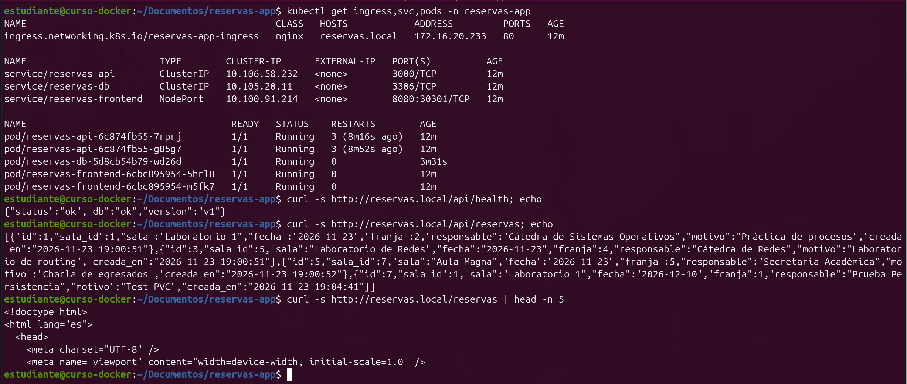
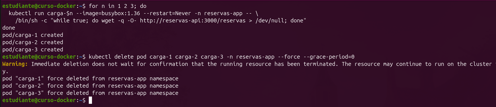
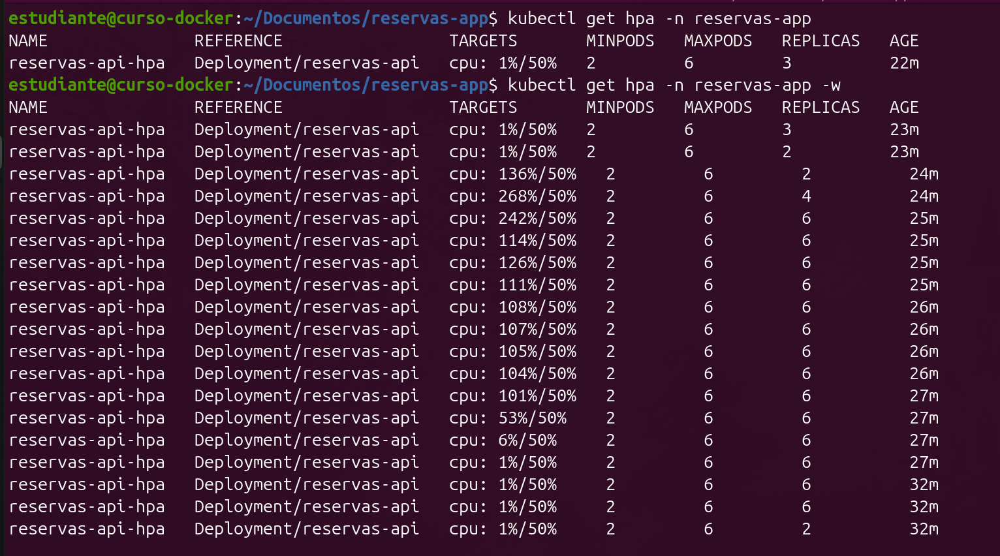
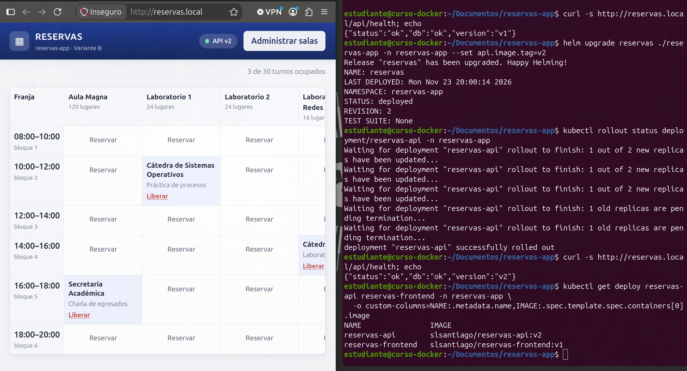
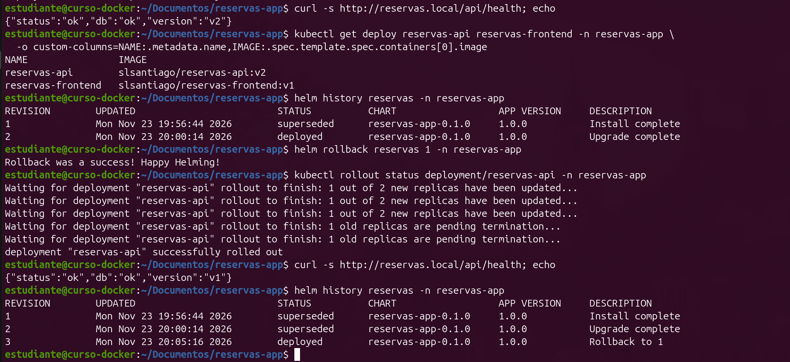
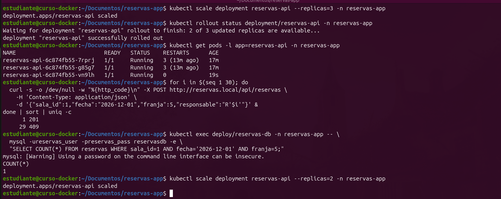
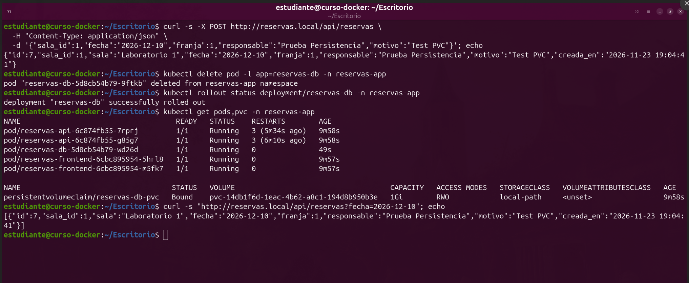

# Informe de Despliegue — `reservas-app`

Este informe documenta las pruebas funcionales y operativas ejecutadas sobre el despliegue de **reservas-app** (**React + Vite · Node.js 20 + Express · MySQL 8.4**) en el clúster de Kubernetes (`namespace: reservas-app`, imágenes publicadas en `slsantiago/reservas-api` y `slsantiago/reservas-frontend`). Cada sección detalla los comandos ejecutados, su evidencia capturada en [`informe/`](./informe) y el análisis técnico del comportamiento observado.

---

## 1. Exposición mediante Ingress y operación de la aplicación

Se verificó la exposición HTTP a través de `reservas-app-ingress` (host `reservas.local`), enrutando `/` hacia el servicio `reservas-frontend:8080`, junto con la resolución de rutas de la API a través del proxy inverso de Nginx (`/api/*` → `reservas-api:3000/*`) y la creación de una reserva desde el navegador.

### Comandos ejecutados

```bash
kubectl get ingress,svc,pods -n reservas-app
curl -s http://reservas.local/api/health
curl -s http://reservas.local/api/reservas
curl -s http://reservas.local/reservas | head -n 5
```

### Evidencia




### Análisis del resultado

- El objeto `reservas-app-ingress` recibe la dirección `172.16.20.233` del `nginx-ingress-controller` y deriva el tráfico de `http://reservas.local` hacia las dos réplicas `Running` (`1/1`) de `reservas-frontend`.
- `GET /api/health` responde `{"status":"ok","db":"ok","version":"v1"}` y `GET /api/reservas` devuelve el listado JSON desde MySQL. En contraste, `GET /reservas` devuelve `200 OK` con `index.html` debido a la directiva `try_files` de la SPA, confirmando que la validación efectiva del backend a través del proxy corresponde al prefijo `/api/`.
- Desde el navegador en `http://reservas.local` se visualizan las cinco salas sembradas, el indicador `API v1` y la reserva creada manualmente desde la interfaz (`clases slatina — prueba`, Laboratorio 2, bloque `14:00–16:00`).

---

## 2. Autoescalado horizontal de la API bajo carga (HPA)

El recurso `reservas-api-hpa` supervisa la utilización de CPU de `reservas-api` respecto del `requests.cpu: 100m` configurado en el Deployment, manteniendo un rango de `2` a `6` réplicas con un umbral objetivo del `50%`.

### Comandos ejecutados

```bash
# Verificación inicial de métricas reportadas por metrics-server
kubectl get hpa -n reservas-app

# Terminal 1: seguimiento en tiempo real del autoescalador
kubectl get hpa -n reservas-app -w

# Terminal 2: generación de carga sostenida contra el Service interno de la API
for n in 1 2 3; do
  kubectl run carga-$n --image=busybox:1.36 --restart=Never -n reservas-app -- \
    /bin/sh -c "while true; do wget -q -O- http://reservas-api:3000/reservas > /dev/null; done"
done

# Detención de los generadores de carga para observar el scale-down
kubectl delete pod carga-1 carga-2 carga-3 -n reservas-app --force --grace-period=0
```

### Evidencia





### Análisis del resultado

- Con `metrics-server` operativo y `resources.requests.cpu` declarado en `reservas-api`, la columna `TARGETS` informa valores porcentuales reales (`1%/50%`) desde el estado en reposo.
- Al lanzar los tres Pods `carga-1`, `carga-2` y `carga-3` consultando en bucle `GET /reservas` (consulta con `JOIN` entre `reservas` y `salas`), la utilización escala hasta `136%/50%` y `268%/50%`, llevando las réplicas de `2` → `4` → `6`.
- Tras eliminar los Pods de carga, el consumo desciende nuevamente a `1%/50%` y, cumplida la ventana de estabilización de *scale-down* (5 minutos, de `27m` a `32m`), el controlador reduce las réplicas de regreso al mínimo configurado (`2`).

---

## 3. Ciclo de vida de releases con Helm (`install`, `upgrade`, `history` y `rollback`)

Se evaluó la administración completa del despliegue mediante el Chart [`reservas-app/`](./reservas-app), ejecutando la instalación inicial con `v1`, una actualización a `v2` únicamente sobre la API y la reversión controlada a la revisión inicial.

### Comandos ejecutados

```bash
# Instalación de la revisión 1 (API v1)
helm install reservas ./reservas-app -n reservas-app --create-namespace
kubectl rollout status deployment/reservas-db -n reservas-app
kubectl rollout status deployment/reservas-api -n reservas-app
kubectl rollout status deployment/reservas-frontend -n reservas-app
kubectl get all,cm,secret,pvc,ingress,hpa -n reservas-app
curl -s http://reservas.local/api/health

# Actualización a revisión 2 (API v2)
helm upgrade reservas ./reservas-app -n reservas-app --set api.image.tag=v2
kubectl rollout status deployment/reservas-api -n reservas-app
curl -s http://reservas.local/api/health
kubectl get deploy reservas-api reservas-frontend -n reservas-app \
  -o custom-columns=NAME:.metadata.name,IMAGE:.spec.template.spec.containers[0].image

# Consulta del historial y reversión a revisión 1 (revisión 3)
helm history reservas -n reservas-app
helm rollback reservas 1 -n reservas-app
kubectl rollout status deployment/reservas-api -n reservas-app
curl -s http://reservas.local/api/health
helm history reservas -n reservas-app
```

### Evidencia





### Análisis del resultado

- `helm history reservas -n reservas-app` registra las tres revisiones completas: revisión `1` (`superseded`, `Install complete`), revisión `2` (`superseded`, `Upgrade complete`) y revisión `3` (`deployed`, `Rollback to 1`).
- Las respuestas de `GET /api/health` y el indicador de versión en la interfaz web confirman la transición `v1` → `v2` → `v1` sin caída del servicio, reflejando la variable `APP_VERSION` definida en tiempo de construcción en cada imagen.
- La inspección de imágenes de los Deployments confirma que `--set api.image.tag=v2` actualiza exclusivamente `reservas-api` (`slsantiago/reservas-api:v2`) mientras `reservas-frontend` conserva `slsantiago/reservas-frontend:v1`, manteniendo ciclos de despliegue independientes por componente.

---

## 4. Validación de parametrización del Chart de Helm (`helm template`)

Se verificó el renderizado estático de las plantillas del Chart para confirmar tanto la cantidad exacta de recursos declarados como el impacto real de los parámetros definidos en [`reservas-app/values.yaml`](./reservas-app/values.yaml).

### Comandos ejecutados

```bash
# Conteo total de objetos renderizados por el chart
helm template prueba ./reservas-app -n reservas-app | grep -c "^kind:"

# Renderizado comparativo de 09-deploy-api.yaml con distintos valores de tag y réplicas
helm template prueba ./reservas-app -n reservas-app \
  -s templates/09-deploy-api.yaml --set api.image.tag=v1 --set api.replicas=2 | grep -E "replicas:|image:"

helm template prueba ./reservas-app -n reservas-app \
  -s templates/09-deploy-api.yaml --set api.image.tag=v2 --set api.replicas=4 | grep -E "replicas:|image:"

# Renderizado de 12-hpa-api.yaml modificando límites y umbral de CPU
helm template prueba ./reservas-app -n reservas-app \
  -s templates/12-hpa-api.yaml --set hpa.maxReplicas=10 --set hpa.targetCPUUtilizationPercentage=70 | grep -E "maxReplicas:|averageUtilization:"
```

### Evidencia


### Análisis del resultado

- El conteo de declaraciones `^kind:` devuelve `12`, confirmando que el Chart genera exactamente los doce objetos de la arquitectura (3 Deployments, 3 Services, 2 ConfigMaps, 1 Secret, 1 PersistentVolumeClaim, 1 Ingress y 1 HorizontalPodAutoscaler).
- Al invocar `helm template` con distintos argumentos `--set`, los manifiestos generados modifican efectivamente la etiqueta de imagen (`slsantiago/reservas-api:v1` frente a `v2`), el número de réplicas (`2` frente a `4`) y los umbrales del HPA (`maxReplicas: 10`, `averageUtilization: 70`), confirmando que los parámetros de `values.yaml` son efectivos.

---

## 5. Integridad ante concurrencia con tres réplicas de la API

Para validar el comportamiento de la aplicación bajo escritura concurrente (analizado en [`ARQUITECTURA.md`](./ARQUITECTURA.md)), se escaló `reservas-api` a tres réplicas y se emitieron 30 solicitudes `POST` simultáneas sobre la misma sala, fecha y franja horaria.

### Comandos ejecutados

```bash
# Escalar la API a 3 réplicas y confirmar disponibilidad
kubectl scale deployment reservas-api --replicas=3 -n reservas-app
kubectl rollout status deployment/reservas-api -n reservas-app
kubectl get pods -l app=reservas-api -n reservas-app

# Enviar 30 peticiones POST concurrentes para la misma sala, fecha y franja
for i in $(seq 1 30); do
  curl -s -o /dev/null -w "%{http_code}\n" -X POST http://reservas.local/api/reservas \
    -H 'Content-Type: application/json' \
    -d '{"sala_id":1,"fecha":"2026-12-01","franja":5,"responsable":"R'$i'"}' &
done | sort | uniq -c

# Verificar en MySQL la cantidad de filas persistidas para esa combinación
kubectl exec deploy/reservas-db -n reservas-app -- \
  mysql -ureservas_user -preservas_pass reservasdb -e \
  "SELECT COUNT(*) FROM reservas WHERE sala_id=1 AND fecha='2026-12-01' AND franja=5;"

# Restablecer el número nominal de réplicas
kubectl scale deployment reservas-api --replicas=2 -n reservas-app
```

### Evidencia



### Análisis del resultado

- Sobre las 30 solicitudes disparadas en paralelo contra las tres réplicas `Running` de `reservas-api`, exactamente **1** finalizó con `201 Created` y **29** recibieron `409 Conflict`.
- La consulta SQL directa contra `deploy/reservas-db` arrojó `COUNT(*) = 1`, demostrando que aun cuando varios procesos Node.js superen simultáneamente la lectura previa (`SELECT`), la restricción `CONSTRAINT sin_solapamiento UNIQUE (sala_id, fecha, franja)` de MySQL impide la doble reserva de forma atómica.

---

## 6. Persistencia de datos en MySQL sobre `PersistentVolumeClaim`

De forma complementaria, se comprobó la supervivencia de los datos ante la eliminación forzada del Pod de base de datos, respaldado por `reservas-db-pvc` montado en `/var/lib/mysql` mediante `subPath: mysql`.

### Comandos ejecutados

```bash
# Crear una reserva de prueba
curl -s -X POST http://reservas.local/api/reservas \
  -H "Content-Type: application/json" \
  -d '{"sala_id":1,"fecha":"2026-12-10","franja":1,"responsable":"Prueba Persistencia","motivo":"Test PVC"}'

# Eliminar el Pod de MySQL y aguardar su recreación
kubectl delete pod -l app=reservas-db -n reservas-app
kubectl rollout status deployment/reservas-db -n reservas-app
kubectl get pods,pvc -n reservas-app

# Confirmar que el registro persiste luego del reinicio
curl -s "http://reservas.local/api/reservas?fecha=2026-12-10"
```

### Evidencia



### Análisis del resultado

- Tras eliminar el Pod `reservas-db-5d8cb54b79-9ftkb`, el Deployment aprovisionó un nuevo Pod (`reservas-db-5d8cb54b79-wd26d`) que volvió a montar el volumen `reservas-db-pvc` (`Bound`, `1Gi`, `RWO`, `local-path`).
- La consulta `GET /api/reservas?fecha=2026-12-10` devolvió el registro `id: 7` (`Prueba Persistencia — Test PVC`) con su marca de tiempo original, verificando que los datos persisten de manera independiente al ciclo de vida del Pod.
